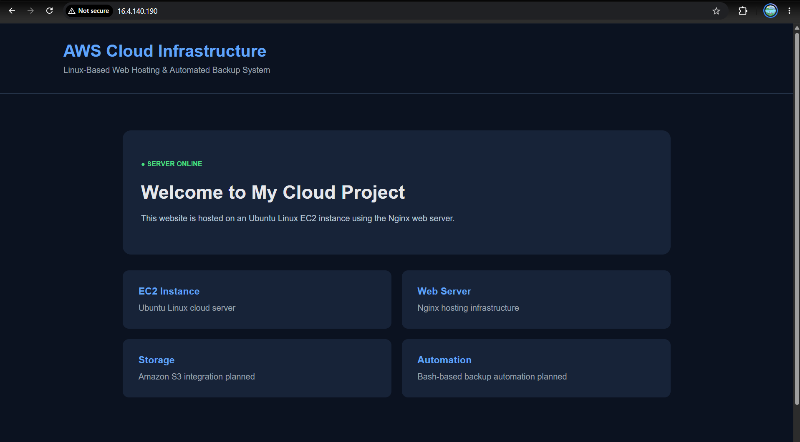
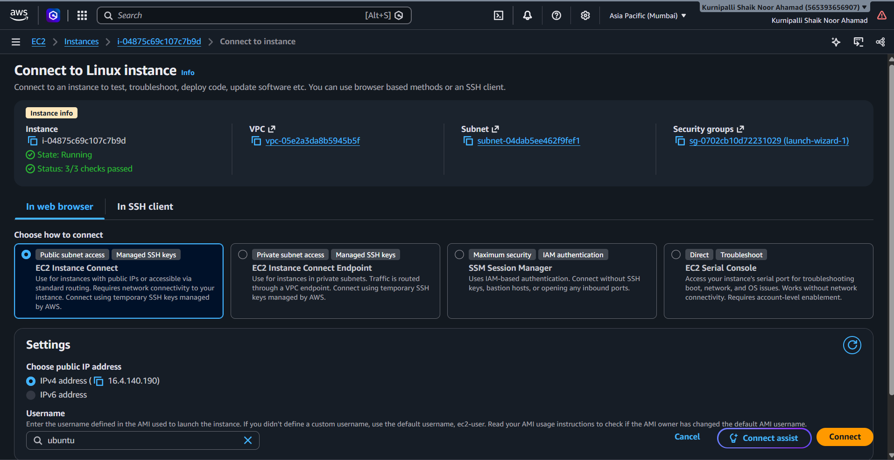
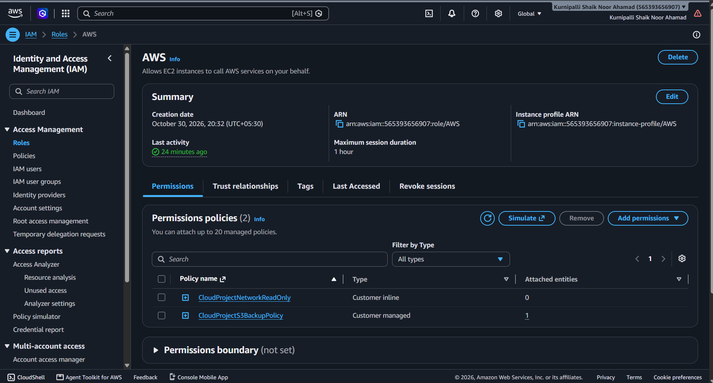
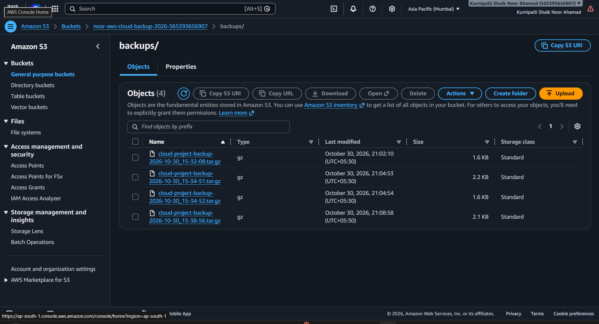
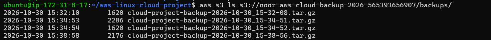

## ⚙️ Project Workflow

This project demonstrates how to host a static website on an AWS EC2 Linux server and automate project backups using Amazon S3.

### 1. Website Hosting

- An Ubuntu EC2 instance is launched in AWS.
- Nginx is installed and configured as the web server.
- Website files are deployed to `/var/www/html`.
- Users access the hosted website through the EC2 public IPv4 address over HTTP.

### 2. AWS Networking

- The EC2 instance runs inside an AWS VPC.
- A public subnet provides network connectivity.
- An Internet Gateway enables communication with the internet.
- The security group allows HTTP traffic on port 80 and restricted SSH access on port 22.

### 3. IAM Role and Security

- An IAM role is attached to the EC2 instance.
- The EC2 instance obtains temporary AWS credentials through its IAM role.
- IAM permissions allow the backup script to interact with the designated S3 bucket.
- No permanent AWS access keys are stored inside the project.

### 4. Automated Backup Process

- A Bash script (`scripts/backup.sh`) automates the backup process.
- The script creates a compressed `.tar.gz` archive of the project files.
- It validates the archive before uploading.
- The AWS CLI uploads the archive to the configured S3 bucket.

### 5. Scheduled Execution

- Linux Cron is configured to execute the backup script daily at 1:00 AM UTC.
- Backup execution logs are written to `backup.log`.
- The EC2 instance must be running at the scheduled time.

### 6. Backup Restoration

- Backup archives are stored in Amazon S3.
- An archive can be downloaded using the AWS CLI.
- The downloaded archive can be extracted to restore the project files.
- Restoration was tested successfully using a downloaded backup archive.

## 🏗️ Architecture Overview

```text
                 Internet Users
                       |
                       v
                Internet Gateway
                       |
                       v
                 AWS VPC
                       |
                       v
                  Public Subnet
                       |
                       v
                 Ubuntu EC2
                       |
                       v
                    Nginx
                       |
                       v
                 Static Website

             Automated Backup Process
                       |
                       v
                 Cron Scheduler
                       |
                       v
                 Bash Script
                       |
                       v
                 Project Archive
                       |
                       v
                AWS CLI + IAM Role
                       |
                       v
                 Amazon S3 Bucket
                       |
                       v
                 Backup Restoration
```

## 🔐 Security Considerations

- SSH access is restricted to an authorized source.
- HTTP access is enabled for website visitors.
- IAM roles are used instead of hardcoded AWS credentials.
- The S3 bucket has public access blocked.
- The S3 bucket uses server-side encryption (SSE-S3).
- Sensitive files and credentials are excluded through `.gitignore`.

## 📸 Project Screenshots

### 1. Website Hosted on AWS EC2



### 2. EC2 Instance Configuration



### 3. IAM Role and Permissions



### 4. Amazon S3 Backup Storage



### 5. Backup and Recovery Process



## 📚 Key Learnings

- Linux server administration and SSH connectivity.
- EC2 instance deployment and Nginx configuration.
- AWS VPC, subnet, route table and security group fundamentals.
- IAM roles and least-privilege access.
- Amazon S3 storage and AWS CLI operations.
- Bash scripting and Cron job automation.
- Backup validation and restoration.
- Git and GitHub version control.